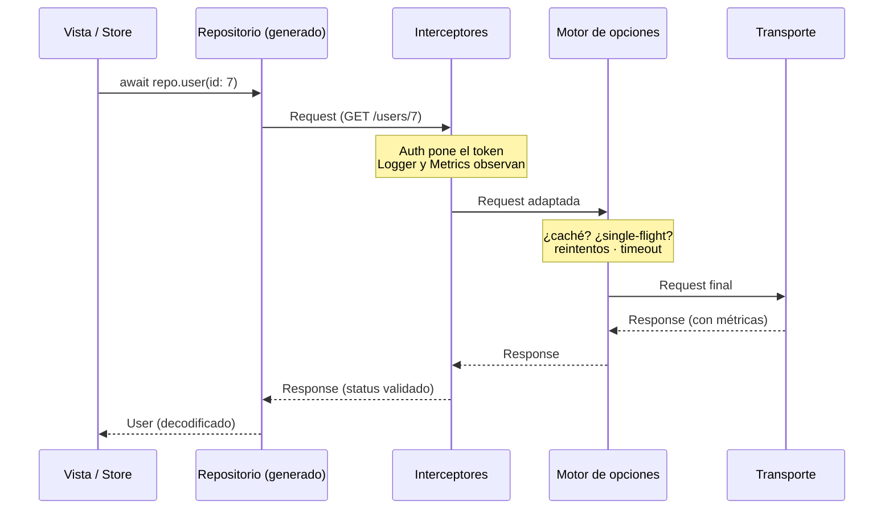

# 1 · Fundamentos

[← Índice](README.md) · Siguiente: [Cliente y entornos →](02-Cliente-y-entornos.md)

## ¿Qué es JadeAPI?

**Qué es.** Una librería de red declarativa para Swift, al estilo de Retrofit: describes tu API con
anotaciones sobre un `protocol` y la librería genera la implementación que hace las peticiones.

**Por qué.** El código de red escrito a mano (armar `URLRequest`, codificar, decodificar, manejar
errores) se repite en cada endpoint y envejece mal. Describiéndolo una vez, el compilador verifica que
la firma, la ruta y los tipos encajan, y la pila de decoradores de
[AnnotationSwift](https://github.com/fsaldivar-dev/experimental-annotation-swift) se apila sobre cada
método como sobre cualquier función.

**Cómo funciona.** Un repositorio es un `protocol`; cada endpoint es un requisito `async throws` con
`@Api`. `@Repository` genera un `struct <Nombre>Client` que conforma el protocolo y, por cada requisito,
arma un `Endpoint` y lo ejecuta con un `AppClient`.

```swift
@Repository
protocol UsersRepository: Sendable {
    @Api("/users/:id")
    func user(id: Int) async throws -> User
}

let users: UsersRepository = UsersRepositoryClient(client: AppClient(baseURL: "https://api.ejemplo.com"))
let paco = try await users.user(id: 7)        // GET /users/7
```

## El viaje de una petición

Entender este camino es entender la librería: cada cosa que configuras vive en una de estas capas.



El primer interceptor de la lista es el más externo; la petición baja por ellos y la respuesta sube en
orden inverso. El motor de opciones aplica las políticas de red justo antes del transporte. Ver
[El pipeline](03-El-pipeline.md) para el detalle de cada capa.

## Declarar un endpoint

[Saltar a parámetros ↓](#parámetros)

**Qué es.** `@Api` describe verbo, ruta y opciones de un requisito.

**Cómo funciona.** Con ruta explícita, los `:parámetros` se rellenan con el argumento del mismo nombre.
Sin argumentos, infiere verbo y ruta del nombre: el prefijo da el verbo (`get`/`fetch`/`find`/`list`
→ GET, `post`/`create`/`add`/`send` → POST, `put`/`replace` → PUT, `patch`/`update` → PATCH,
`delete`/`remove` → DELETE) y el resto, en kebab-case, la ruta. `getUserProfile()` → `GET /user-profile`.

```swift
@Api("/auth/login", method: .post)
func login(username: String, password: String) async throws -> Token   // POST, body JSON

@Api                                 // GET /orders (inferido de getOrders)
func getOrders() async throws -> [Order]
```

La ruta explícita es la recomendación; la inferencia es azúcar para prototipos. Si la inferencia manda
un parámetro a la query y podría ser de ruta, la macro avisa en compilación.

## Parámetros

**Cómo funciona.** Por defecto, en GET/DELETE los parámetros van a la query y en POST/PUT/PATCH al body
JSON. Para forzar el sitio, se envuelven en `Path`, `Query`, `Header` o `Body`.

```swift
@Api("/search")
func search(q: String, page: Int?, limit: Query<Int>) async throws -> [Hit]
//          └ query    └ nil se omite  └ explícito

@Api("/me")
func me(token: Header<String>) async throws -> Profile     // va en el header "token"

@Api("/orders", method: .post)
func create(order: Body<Order>) async throws -> Order      // el objeto entero como body
```

Un `Optional` con valor `nil` se omite. Falta un `:parámetro` de la ruta → error de compilación.

## Objeto de petición (@ApiRequest)

[Saltar a configurarlo ↓](#)

**Qué es.** Un `struct` con `@ApiRequest` que agrupa los parámetros de un endpoint. Se usa como el
**único** parámetro de un `@Api` y sus campos se despliegan en la petición.

**Por qué.** Una firma con ocho o diez parámetros es ilegible y frágil en la llamada; y la misma forma
suele repetirse en varios endpoints. Un objeto con campos nombrados es más claro y reutilizable. Es el
espejo del lado de la respuesta: allí mapeas DTO → dominio, aquí dominio → cable.

**Cómo funciona.** Cada campo decide su destino por el tipo: `Path<T>`, `Query<T>`, `Header<T>` y
`Body<T>` son explícitos; un campo pelón o con `@Parameter` infiere por el verbo (query en GET/DELETE,
campo del body en POST/PUT/PATCH). El macro lee los campos y genera el aporte al `Endpoint`.

```swift
@ApiRequest
struct CreateOrder {
    @Parameter var items: [LineItem]     // body (es POST)
    @Parameter var coupon: String?       // body; nil se omite
    var idempotencyKey: Header<String>   // explícito: va al header
}

@Api("/orders", method: .post)
func create(_ order: CreateOrder) async throws -> Order
```

Un parámetro suelto de un tipo tuyo (no primitivo) se asume `@ApiRequest`; si no lo es, no compila, con
un error que te dice que lo anotes o lo envuelvas en `Body<…>`. Para mandar un objeto como body crudo
sin desplegarlo, usa `Body<T>` en la firma.

**En la demo.** Pestaña Catálogo: el buscador usa `ProductQuery` (`@ApiRequest`) contra
`/products/search`. Ver [`CatalogRepository`](../Examples/Guide/Sources/GuideCore/Network/Repositories/CatalogRepository.swift).

## Respuestas y errores

**Cómo funciona.** El retorno puede ser `Decodable`, `Data`, `String`, `Void` o `Response` (status,
headers, body crudos). Las respuestas 2xx se entregan; el resto lanza, siempre tipado como `HTTPError`:

| Caso | `HTTPError` |
| --- | --- |
| Status fuera de 2xx | `.status(Int, Response)` |
| No decodifica al tipo de retorno | `.decoding(any Error, Response)` |
| Fallo de red (sin conexión, DNS, TLS) | `.transport(any Error)` |
| Se superó el timeout | `.timeout(Duration, Request)` |
| URL inválida o falta un `:parámetro` | `.invalidURL(String)` |
| `http://` fuera de Debug | `.insecureURL(URL)` |
| La `Task` se canceló | `.cancelled` |

`error.statusCode` devuelve el código si es `.status`. Cancelar la `Task` que hace el `await` cancela
la petición. Para convertir el body de un error en un error de dominio, ver
[Transformadores](03-El-pipeline.md#transformadores).
