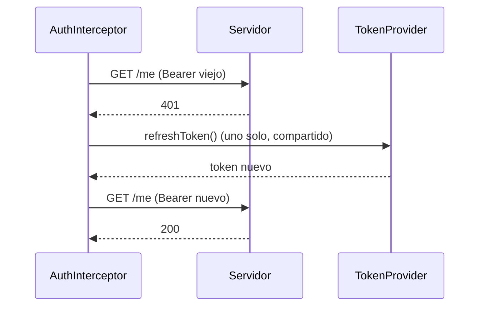
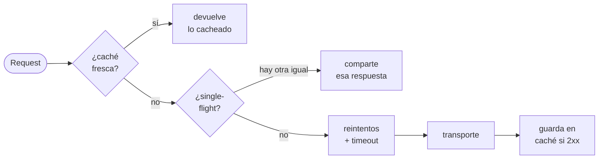

# 3 · El pipeline

[← Cliente y entornos](02-Cliente-y-entornos.md) · [Índice](README.md) · Siguiente: [Transporte avanzado →](04-Transporte-avanzado.md)

Tres capas, una regla de bolsillo: **interceptor** si tocas HTTP, **decorador** si tocas la llamada,
**transformador** si tocas datos. Todo lo de este tema vive entre que el `AppClient` arma la `Request` y
que el transporte la envía.

## Interceptores

[Saltar a configurarlo ↓](#configurar--interceptores)

**Qué es.** Envuelven el HTTP crudo: ven la `Request` antes de que salga y la `Response` cuando vuelve.

**Por qué.** Headers comunes, autenticación, logs y métricas no pertenecen a ningún endpoint concreto;
son transversales. Y algunos, como el refresh de token, necesitan ver el status y repetir la petición.

**Cómo funciona.** Son una lista ordenada: el primero es el más externo. La petición baja por ellos y la
respuesta sube en orden inverso. Cada uno puede mutar, cortar, reintentar o transformar.

```swift
struct SignRequest: Interceptor {
    func intercept(_ request: Request, next: Next) async throws -> Response {
        var request = request
        request.headers["X-Signature"] = sign(request.body)
        return try await next(request)        // llamar a next sigue la cadena; no llamarlo la corta
    }
}
```

Atajos: `RequestAdapter` (solo toca la petición) y `ResponseInterceptor` (solo la respuesta).

<a id="configurar--interceptores"></a>
**Configurar.**

```swift
environment.interceptors = [
    MetricsInterceptor { report in telemetry.record(report) },  // el más externo: mide todo, reintentos incluidos
    AuthInterceptor(tokens: tokens),
    RequestLogger(.curl),                                       // el más interno: ve la petición ya firmada
]
```

Para un solo repositorio, `@Interceptors(SignRequest())` sobre el protocolo.

**En la demo.** [`AppEnvironment.swift`](../Examples/Guide/Sources/GuideCore/Environment/AppEnvironment.swift)
pone Metrics, Auth y Logger; el panel derecho muestra lo que escribe el logger.

## Autenticación

[Saltar a configurarlo ↓](#configurar--autenticación)

**Qué es.** `AuthInterceptor` inyecta `Authorization: Bearer …` y, ante un 401, refresca el token una vez
y repite la petición.

**Por qué.** Es el caso canónico de interceptor: necesita ver el status de la respuesta (el 401) y
reintentar con un header distinto. Un `TokenProvider` desacopla *de dónde* sale el token (memoria,
Keychain, un flujo OIDC) de *cómo* se usa.

**Cómo funciona.** Varias peticiones que reciben 401 a la vez comparten un único refresh (no hay una
tormenta de refrescos). Una petición que salió **sin** token no dispara refresh: ese 401 es de verdad
(por ejemplo, un login con credenciales malas).



<a id="configurar--autenticación"></a>
**Configurar.**

```swift
AuthInterceptor(tokens: miTokenProvider)                     // refresca en 401 por defecto
AuthInterceptor(tokens: miTokenProvider, refreshOn: [401, 419])
```

**En la demo.** [`SessionStore`](../Examples/Guide/Sources/GuideCore/Features/Session/SessionStore.swift)
nunca pasa el token a mano: entra en sesión y `GET /auth/me` sale con el Bearer puesto por el interceptor.

**Desarrollo seguro.** El `TokenProvider` de producción guarda el token en el Keychain, no en memoria ni
en `UserDefaults`. Ver [Keychain y tokens](05-Desarrollo-seguro.md#keychain-y-tokens).

## El motor de opciones

Caché, single-flight, reintentos y timeout no son interceptores: son **opciones** que el cliente aplica
entre los interceptores y el transporte. Van juntas porque un `Decorator` genérico no puede cancelar ni
compartir un resultado no `Sendable`, y estas políticas son puro HTTP. El orden del motor:



### Caché

[Saltar a configurarlo ↓](#configurar--caché)

**Qué es.** Guarda en memoria las respuestas 2xx de un endpoint durante un tiempo.

**Por qué.** Evita repetir peticiones idénticas (una lista que se recarga, un detalle que se reabre). Vive
en el motor, no en un interceptor, para que un acierto se salte la **red** pero la decisión siga por
debajo de tu auth y tus logs.

**Cómo funciona.** Clave = verbo + URL + body. Solo cachea 2xx. Es en memoria y se va al cerrar la app.

<a id="configurar--caché"></a>
```swift
@CacheFor(.seconds(30))
@Api("/products")
func featured() async throws -> [Product]
```

**En la demo.** Catálogo: la segunda carga de destacados no toca la red.

### Reintentos e idempotencia

[Saltar a configurarlo ↓](#configurar--reintentos)

**Qué es.** `@Retries` reintenta a nivel HTTP: errores de transporte, 5xx, 408 y 429. Nunca 4xx de
negocio ni errores de decodificación.

**Por qué.** Reintentar un GET es seguro; reintentar un POST puede cobrar dos veces. Por eso un POST o
PATCH solo se reintenta si es idempotente: `@Idempotent` manda un header `Idempotency-Key` único que el
servidor usa para no duplicar el efecto.

<a id="configurar--reintentos"></a>
```swift
@Retries(3, backoff: .exponential(.seconds(1), max: .seconds(30)))
@Api("/products") func featured() async throws -> [Product]

@Idempotent                                   // sin esto, la macro rechaza @Retries en un POST
@Retries(2)
@Api("/payments", method: .post) func pay(_ body: Body<Charge>) async throws -> Receipt
```

Respeta `Retry-After` del servidor. La macro da error si pones `@Retries` en un POST sin `@Idempotent`
(o `@Retries(1)` para desactivarlo explícitamente).

### Single-flight

**Qué es.** Peticiones idénticas en vuelo comparten una sola respuesta.

**Por qué.** Si tres pantallas piden el mismo producto a la vez, sale una petición, no tres.

```swift
@SingleFlight
@Api("/products/:id") func product(id: Int) async throws -> Product
```

### Timeout

**Qué es.** Tiempo máximo de la petición, vigilado por el cliente además del `URLRequest`.

```swift
@Api("/products/:id", timeout: .seconds(5)) func product(id: Int) async throws -> Product
```

## Transformadores

[Saltar a configurarlo ↓](#configurar--transformadores)

**Qué es.** Convierten entre lo que viaja por el cable (DTO) y lo que usa tu app (dominio), con un tipo
`Transformer`, verificado por el compilador.

**Por qué.** El JSON del servidor no debería mandar en tus modelos: nombres, formas y envoltorios cambian
sin que tu dominio tenga que cambiar. Un mapper como **tipo** (no un closure) deja que el compilador
verifique que el DTO decodificado y el retorno encajan.

**Cómo funciona.** `@Unwrap("data")` decodifica solo un sub-árbol; `@Transform(Mapper.self)` pasa DTO a
dominio; `@ErrorTransform(Mapper.self)` convierte el body de un error en un error de dominio. Sobre el
protocolo aplican a todos los endpoints; sobre un requisito, solo a ese (y gana).

<a id="configurar--transformadores"></a>
```swift
struct ProductMapper: Transformer {
    func transform(_ dto: ProductDTO) throws -> Product {
        Product(id: dto.id, name: dto.title, price: Decimal(dto.price))
    }
}

@Unwrap("data")                         // {"data": {…}} → {…}
@Transform(ProductMapper.self)          // ProductDTO → Product
@Api("/products/:id") func product(id: Int) async throws -> Product
```

**En la demo.** [`CatalogRepository`](../Examples/Guide/Sources/GuideCore/Network/Repositories/CatalogRepository.swift)
usa los tres; el error del producto inexistente llega como `CatalogError`, no como `HTTPError`.

## Grupos de peticiones

[Saltar a configurarlo ↓](#configurar--grupos)

**Qué es.** Lanzar varias peticiones a la vez con control de concurrencia, en vez de una tras otra.

**Por qué.** Una pantalla suele necesitar varias cosas al abrirse. Lanzarlas en serie suma latencias;
lanzarlas todas sin límite satura la red. Un grupo con tope es el término medio.

**Cómo funciona.** `all` espera varias peticiones distintas y devuelve una tupla tipada. `group` lanza N
iguales con límite y lanza si una falla; `groupSettled` devuelve un `Result` por cada una, así un fallo
no tumba al resto.

<a id="configurar--grupos"></a>
```swift
let (featured, categories) = try await client.all(
    { try await repo.featured() },
    { try await repo.categories() }
)

let results = await client.groupSettled(maxConcurrent: 2) { group in
    for id in ids { group.add { try await repo.product(id: id) } }
}
```

**En la demo.** [`CatalogStore`](../Examples/Guide/Sources/GuideCore/Features/Catalog/CatalogStore.swift)
carga destacados y categorías con `all`, y el detalle de cada uno con `groupSettled`.
