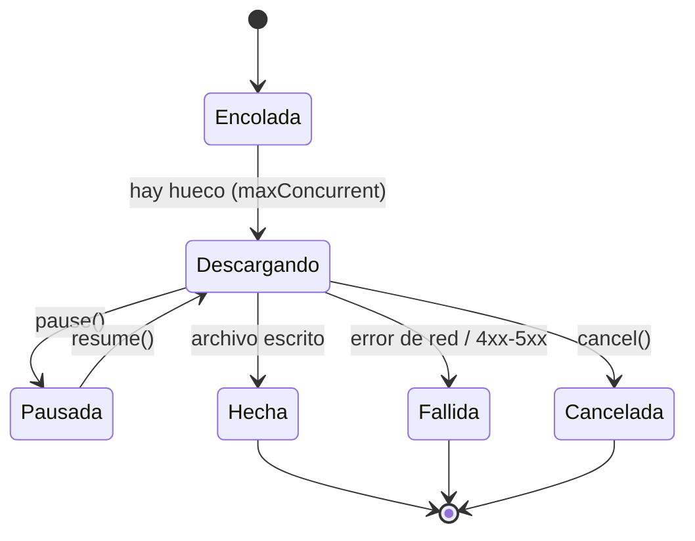
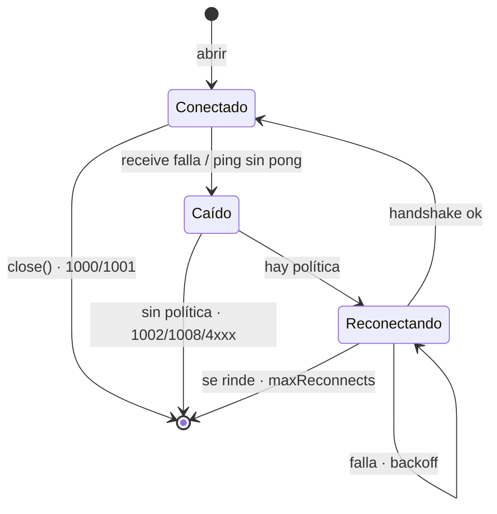

# 4 · Transporte avanzado

[← El pipeline](03-El-pipeline.md) · [Índice](README.md) · Siguiente: [Desarrollo seguro →](05-Desarrollo-seguro.md)

Hasta aquí el retorno era un valor. Hay tres familias más —stream, transferencia y conexión— y se eligen
con una sola palabra: `kind:` en `@Api`, o `@Socket`.

## Streaming (SSE y NDJSON)

[Saltar a configurarlo ↓](#configurar--streaming)

**Qué es.** Una respuesta que llega por partes y se consume conforme fluye, en vez de esperar al final.

**Por qué.** Hay respuestas que no terminan (eventos en vivo) o que son tan largas que esperar al cierre
desperdicia memoria y tiempo: ediciones de una wiki, tokens de un LLM, un export de miles de filas.

**Cómo funciona.** `kind:` elige el formato y el tipo de retorno pasa a ser un `AsyncThrowingStream`:
`.bytes` (trozos crudos), `.lines` (texto por línea), `.ndjson` (un `Decodable` por línea), `.sse`
(eventos `ServerEvent`). El stream empieza al hacer `await`, valida el status antes de entregar nada, y
**cancelar la `Task` que lo consume cierra la conexión**.

<a id="configurar--streaming"></a>
```swift
@Api("/v2/stream/recentchange", kind: .sse)
func recentChanges() async throws -> AsyncThrowingStream<ServerEvent, any Error>

for try await event in try await wiki.recentChanges() {
    let change = try event.decode(WikiChange.self)   // event.data es JSON
    …
}
```

**En la demo.** Pestaña Stream: ediciones de Wikipedia en vivo contra `stream.wikimedia.org`.
[`WikiStore`](../Examples/Guide/Sources/GuideCore/Features/Stream/WikiStore.swift) arranca y para el
stream cancelando su `Task`.

## Descargas y colas

[Saltar a configurarlo ↓](#configurar--descargas)

**Qué es.** `kind: .download` devuelve un `Download` con progreso y archivo final; `DownloadQueue` encola
varios con un límite de descargas simultáneas.

**Por qué.** Un archivo grande necesita progreso, pausa y reanudación, no un `await` opaco. Y bajar diez
archivos a la vez satura la red del móvil; una cola con tope los ordena.

**Cómo funciona.** `Download` expone `progress` (un `AsyncStream<TransferProgress>`), `file()` (espera y
devuelve la URL), `cancel()`, `pause()`/`resume()`. La cola reparte el trabajo y agrega el progreso; una
descarga es un ciclo de vida:



<a id="configurar--descargas"></a>
```swift
@Api("/seed/:seed/800/500", kind: .download)
func photo(seed: String) async throws -> Download

let queue = DownloadQueue(maxConcurrent: 2)
for seed in seeds { await queue.enqueue { try await photos.photo(seed: seed) } }
for await progress in queue.progress { update(progress.fractionCompleted) }
let results = await queue.settled()        // un Result por descarga; un fallo no tumba al resto
```

**En la demo.** Pestaña Descargas: cinco fotos de `picsum.photos` de dos en dos.
[`DownloadsStore`](../Examples/Guide/Sources/GuideCore/Features/Downloads/DownloadsStore.swift).

## WebSocket y reconexión

[Saltar a configurarlo ↓](#configurar--websocket)

**Qué es.** `@Socket` abre un WebSocket tipado: `Socket<Saliente, Entrante>` con `send`, un stream
`messages` y, opcionalmente, reconexión automática.

**Por qué.** Un chat o un feed en tiempo real necesita conexión viva en los dos sentidos. Y las redes
móviles se caen: volver de segundo plano o cambiar de wifi a datos corta el socket. Una política de
reconexión te evita re-escribir ese baile en cada app.

**Cómo funciona.** `String` viaja como texto, `Data` como binario, cualquier `Codable` como JSON. Con una
política, una caída no termina `messages`: el socket reconecta con backoff, cada intento repite el
handshake por los interceptores (token fresco), y `events` te cuenta qué pasa. `send` sin conexión lanza
`SocketDisconnected`: no hay cola oculta. Esta es la máquina de estados:



No reconecta ante cierre normal (1000, 1001), `close()`, errores de protocolo o de política
(1002, 1003, 1007–1010, 4xxx) ni handshakes rechazados con 4xx salvo 408 y 429.

<a id="configurar--websocket"></a>
```swift
@Socket("/ws/chat/:room", reconnect: .exponential(.seconds(1), max: .seconds(30)), keepAlive: .seconds(30))
func chat(room: String) async throws -> Socket<Outgoing, Incoming>

let socket = try await rooms.chat(room: "general")
for await event in socket.events {
    if case .connected(let attempt) = event, attempt > 0 { try await socket.send(.subscribe("general")) }
}
socket.reconnect()        // forzar una, p. ej. al volver de segundo plano
```

**En la demo.** Pestaña Socket: eco contra `echo.websocket.org`, con un botón que fuerza la reconexión.
[`EchoStore`](../Examples/Guide/Sources/GuideCore/Features/Socket/EchoStore.swift).

## Métricas de transporte

[Saltar a configurarlo ↓](#configurar--métricas)

**Qué es.** Lo que midió el transporte en cada petición: duración, DNS, conexión, TLS, primer byte,
bytes, protocolo, si reusó conexión.

**Por qué.** "La app va lenta" se diagnostica con números: ¿es el DNS, el handshake TLS, el servidor
tardando en el primer byte, o la descarga? Sin métricas es adivinar.

**Cómo funciona.** `Response.metrics` trae un `TransportMetrics` (de `URLSessionTaskMetrics`; sintético en
`MockClient`) y `Response.attempts` cuántos intentos hizo `@Retries`. Para telemetría, un
`MetricsInterceptor` en la capa más externa entrega un `MetricsReport` por petición, con la petición ya
redactada. `RequestLogger` añade duración, primer byte y protocolo a su línea.

<a id="configurar--métricas"></a>
```swift
environment.interceptors = [MetricsInterceptor { report in
    // report: request redactada · status · elapsed (reintentos incluidos) · attempts · transport
    telemetry.record(report)
}]
```

Para un stream, `await streaming.metrics.value` resuelve cuando termina.

**En la demo.** Pestaña Métricas: resume por endpoint (llamadas, fallos, media, primer byte, protocolo).
[`MetricsLog`](../Examples/Guide/Sources/GuideCore/Diagnostics/MetricsLog.swift).
