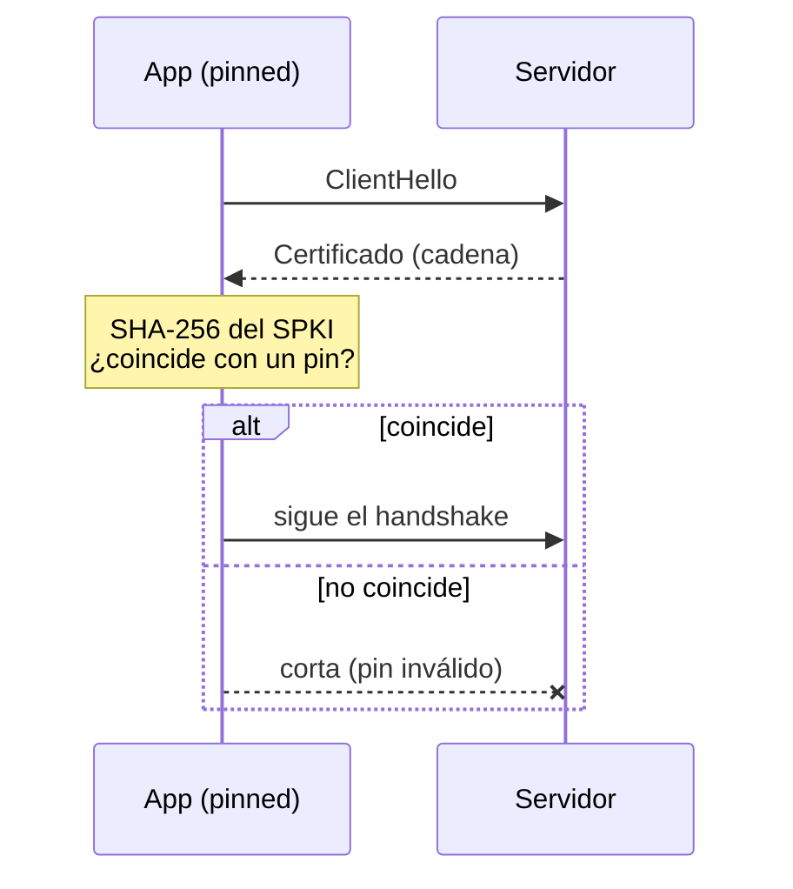

# 5 · Desarrollo seguro

[← Transporte avanzado](04-Transporte-avanzado.md) · [Índice](README.md)

La seguridad no es una capa, es transversal: toca el transporte (pinning, mTLS), los interceptores (DPoP,
firmas, attest), el entorno (dónde viven secretos y URLs) y el almacenamiento (Keychain). El modelo de
amenaza completo y el mapeo a MASVS 2.0 están en [`SECURITY.md`](../SECURITY.md).

## Modelo de amenaza

**Qué protege cada pieza.** Una app móvil corre en un equipo que no controlas, con un usuario que puede
ser un atacante. Las defensas responden a amenazas concretas:

| Amenaza | Defensa | Tema |
| --- | --- | --- |
| Alguien lee el tráfico con un proxy o una CA instalada | SSL pinning | [↓](#ssl-pinning) |
| Secretos extraídos del binario (`strings`, un decompilador) | Nada de secretos en el cliente | [↓](#dónde-viven-los-secretos) |
| Un token robado se reusa en otro dispositivo | DPoP / tokens atados al emisor | [↓](#dpop) |
| El cuerpo de una petición se altera en tránsito | Firma de peticiones (RFC 9421) | [↓](#firma-de-peticiones) |
| Una app clonada o modificada habla con tu API | App Attest | [↓](#app-attest) |
| El token en reposo en el dispositivo | Keychain, no `UserDefaults` | [↓](#keychain-y-tokens) |

Casi todo es opcional y se apila según lo pida tu sector: una app de notas no necesita App Attest; un
banco, sí todo.

## SSL pinning

[Saltar a configurarlo ↓](#configurar--pinning)

**Qué es.** Fijar la identidad criptográfica de tu servidor dentro de la app, para que solo confíe en
*ese* servidor y no en cualquiera con un certificado técnicamente válido.

**Por qué.** El TLS normal confía en ~150 autoridades del sistema. Si una emite un certificado para tu
dominio (por error o por coacción), o el usuario tiene un proxy corporativo con su CA, o una herramienta
de interceptación, el tráfico se lee sin que la app lo note. El pinning corta eso. Lo pide
MASVS-NETWORK-1. **Cuándo no**: si tu backend rota certificados sin avisar o usas un CDN que no controlas,
el pinning puede tirar la app; por eso, siempre con respaldo.

**Cómo funciona.** No se fija el certificado entero (caduca y rota), sino el hash SHA-256 de su clave
pública (el SPKI). En el handshake, `URLSession` entrega la cadena a un delegado; JadeAPI calcula el SPKI
y lo compara con tus pines. Fijas dos o más (el de hoy y el de la próxima renovación) para rotar sin
publicar una versión.



<a id="configurar--pinning"></a>
**Configurar.** Saca el hash de tu servidor:

```bash
openssl s_client -connect api.tuapp.com:443 </dev/null 2>/dev/null \
  | openssl x509 -pubkey -noout | openssl pkey -pubin -outform der \
  | openssl dgst -sha256 -binary | openssl enc -base64
```

En código (un `PublicKeyPin` se escribe como string literal):

```swift
let policy = PinningPolicy(hosts: [
    "api.tuapp.com": .init(
        ["AAAA…", "BBBB…"],                              // el de hoy y el de respaldo
        expires: Date(timeIntervalSinceNow: 60*60*24*90), // caduca en 90 días: te obliga a revisarlo
        includesSubdomains: true)
])
let client = AppClient(baseURL: "https://api.tuapp.com", transport: .pinned(policy))
```

En el nivel 2, sin tocar código, va en el Info.plist del servicio: `pins` (hashes separados por coma) y
`pinsExpire` (fecha). `Environment.client(for:)` ya devuelve el transporte con pinning.

**Trampas.** Un solo pin sin respaldo = app ladrillo el día que renueves. Pin sin caducidad = nadie lo
actualiza. Pinnear un host de un CDN ajeno = se rompe cuando el CDN rota.

**En la demo.** Se explica, no se ejecuta: pinnear `dummyjson`/`picsum` reales requiere sus hashes, que
rotan y tirarían la CI.

## Dónde viven los secretos

**Qué es.** La regla de dónde pueden estar las URLs, las claves y los tokens.

**Por qué.** Todo lo que compilas en el binario es público: `strings` sobre el `.app` saca cualquier
constante. Un secreto en el código no es un secreto.

**Cómo funciona.** Las URLs y flags por entorno van en `.xcconfig` + Info.plist (ver
[Entornos](02-Cliente-y-entornos.md#entornos-y-servicios)); el `.xcconfig` local con tu sandbox queda en
`.gitignore`. Los secretos de verdad no van en el cliente: se obtienen en runtime (un `TokenProvider`) o
viven en un backend intermedio. `SecurityAudit` avisa en Debug si fijas un header con pinta de credencial,
y `SecurityPolicy` prohíbe `http://` fuera de Debug.

**Desarrollo seguro.** Lo que no está en `Release.xcconfig` no existe en el binario de tienda: ese es el
objetivo. Overrides y logs de red solo en Debug.

## Keychain y tokens

[Saltar a configurarlo ↓](#configurar--keychain)

**Qué es.** `KeychainTokenProvider` guarda el token en el Keychain del dispositivo y lo refresca cuando
caduca; encaja directo en `AuthInterceptor`.

**Por qué.** `UserDefaults` es un plist en claro; cualquier backup o acceso al sistema de archivos lo lee.
El Keychain está cifrado por el hardware y puede atarse a que el dispositivo esté desbloqueado.

**Cómo funciona.** `StoredTokens` (access, refresh, caducidad) se serializa en un `KeychainStore`.
`currentToken()` devuelve el vigente; si caducó, `refreshToken()` llama a tu closure de refresh una vez.

<a id="configurar--keychain"></a>
```swift
let store = SecItemKeychainStore(service: "com.tuapp", protection: .afterFirstUnlock)
let tokens = KeychainTokenProvider(store: store, key: "jade.session") { refresh in
    try await auth.refresh(refresh)           // tu endpoint de refresh → StoredTokens
}
environment.interceptors = [AuthInterceptor(tokens: tokens)]
```

En pruebas, `InMemoryKeychainStore`.

## DPoP

**Qué es.** Tokens atados al emisor (RFC 9449): cada petición lleva una prueba firmada con una clave que
solo vive en este dispositivo.

**Por qué.** Un `Bearer` robado sirve en cualquier parte. Con DPoP, el token sin la clave del dispositivo
no vale: robar el token no basta.

**Cómo funciona.** `DPoPInterceptor` firma cada petición con una `SigningKey` (idealmente en el Secure
Enclave) y reacciona al `DPoP-Nonce` del servidor.

```swift
let key = try P256SigningKey(preferSecureEnclave: true)
environment.interceptors = [DPoPInterceptor(key: key, tokens: tokens)]
```

## Firma de peticiones

**Qué es.** `SignedRequestInterceptor` firma la petición (RFC 9421) y añade un `Content-Digest` (RFC 9530)
del body.

**Por qué.** Garantiza al servidor que la petición viene de quien dice y que nadie alteró el cuerpo en
tránsito, incluso sobre TLS roto por un intermediario.

```swift
SignedRequestInterceptor(key: key, coveredHeaders: ["authorization", "content-digest"])
```

## App Attest

**Qué es.** `AppAttestInterceptor` demuestra al servidor que la petición viene de una copia legítima y sin
modificar de tu app en un dispositivo real de Apple.

**Por qué.** Impide que una app clonada, parcheada o un script hablen con tu API haciéndose pasar por tu
app.

**Cómo funciona.** Usa `DeviceCheckAttestor` (App Attest de Apple) contra un `ChallengeProvider` que da
los retos de tu servidor; guarda la clave en el Keychain.

```swift
AppAttestInterceptor(attestor: DeviceCheckAttestor(), challenges: misRetos, store: store)
```

## Login OIDC

[Saltar a configurarlo ↓](#configurar--oidc)

**Qué es.** `AuthorizationFlow` hace login en el navegador del sistema al estilo FAPI 2.0: descubrimiento
del issuer, PKCE, PAR cuando el servidor lo ofrece, e intercambio del código con prueba DPoP.

**Por qué.** Es el estándar de autenticación delegada (entrar con tu identidad corporativa o social) hecho
bien: sin webviews que roban credenciales, con el código protegido por PKCE y los tokens atados por DPoP.

**Cómo funciona.** `OpenIDDiscovery` lee la configuración del issuer (verificando https y PKCE S256),
`WebAuthenticationPresenter` abre `ASWebAuthenticationSession`, y el flujo intercambia el código,
comprueba los claims del `id_token` y devuelve `StoredTokens` listos para el Keychain.

<a id="configurar--oidc"></a>
```swift
let flow = AuthorizationFlow(
    issuer: URL(string: "https://login.tuapp.com")!,
    clientID: "ios-app",
    redirectURI: URL(string: "tuapp://callback")!,
    scopes: ["openid", "profile", "offline_access"],
    client: client,
    key: try P256SigningKey(),                 // ata los tokens por DPoP
    presenter: WebAuthenticationPresenter()
)
let tokens = try await flow.signIn()           // abre el navegador del sistema
```
