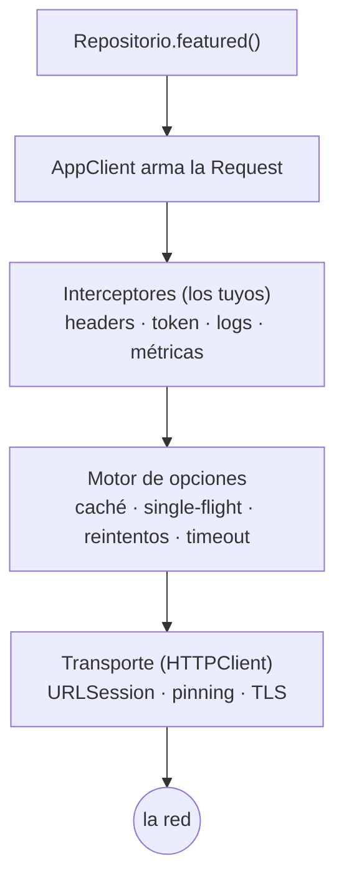

# Documentación de JadeAPI

Esta documentación explica *por qué* la librería está hecha así, no solo cómo se llama. La app
[`Examples/Guide`](../Examples/Guide) lo demuestra corriendo; aquí entiendes dónde encaja cada pieza.

Cada tema sigue la misma estructura: **qué es · por qué · cómo funciona · cómo se configura · en la
demo · desarrollo seguro**. Debajo de cada título hay un enlace para saltar directo a la configuración
si solo quieres implementar.

## Índice

### [1 · Fundamentos](01-Fundamentos.md)
[¿Qué es JadeAPI?](01-Fundamentos.md#qué-es-jadeapi) ·
[El viaje de una petición](01-Fundamentos.md#el-viaje-de-una-petición) ·
[Declarar un endpoint](01-Fundamentos.md#declarar-un-endpoint) ·
[Parámetros](01-Fundamentos.md#parámetros) ·
[Respuestas y errores](01-Fundamentos.md#respuestas-y-errores)

### [2 · Cliente y entornos](02-Cliente-y-entornos.md)
[AppClient](02-Cliente-y-entornos.md#appclient) ·
[El transporte (HTTPClient)](02-Cliente-y-entornos.md#el-transporte-httpclient) ·
[Entornos y servicios](02-Cliente-y-entornos.md#entornos-y-servicios) ·
[Ajustes del repositorio](02-Cliente-y-entornos.md#ajustes-del-repositorio)

### [3 · El pipeline](03-El-pipeline.md)
[Interceptores](03-El-pipeline.md#interceptores) ·
[Autenticación](03-El-pipeline.md#autenticación) ·
[Caché](03-El-pipeline.md#caché) ·
[Reintentos e idempotencia](03-El-pipeline.md#reintentos-e-idempotencia) ·
[Single-flight](03-El-pipeline.md#single-flight) ·
[Timeout](03-El-pipeline.md#timeout) ·
[Transformadores](03-El-pipeline.md#transformadores) ·
[Grupos de peticiones](03-El-pipeline.md#grupos-de-peticiones)

### [4 · Transporte avanzado](04-Transporte-avanzado.md)
[Streaming (SSE y NDJSON)](04-Transporte-avanzado.md#streaming-sse-y-ndjson) ·
[Descargas y colas](04-Transporte-avanzado.md#descargas-y-colas) ·
[WebSocket y reconexión](04-Transporte-avanzado.md#websocket-y-reconexión) ·
[Métricas de transporte](04-Transporte-avanzado.md#métricas-de-transporte)

### [5 · Desarrollo seguro](05-Desarrollo-seguro.md)
[Modelo de amenaza](05-Desarrollo-seguro.md#modelo-de-amenaza) ·
[SSL pinning](05-Desarrollo-seguro.md#ssl-pinning) ·
[Dónde viven los secretos](05-Desarrollo-seguro.md#dónde-viven-los-secretos) ·
[Keychain y tokens](05-Desarrollo-seguro.md#keychain-y-tokens) ·
[DPoP](05-Desarrollo-seguro.md#dpop) ·
[Firma de peticiones](05-Desarrollo-seguro.md#firma-de-peticiones) ·
[App Attest](05-Desarrollo-seguro.md#app-attest) ·
[Login OIDC](05-Desarrollo-seguro.md#login-oidc)

## La idea central

> Una petición tiene un camino fijo. Cada función que configuras se enchufa en **una** capa de ese
> camino. Si sabes en qué capa vive algo, sabes qué puede y qué no puede hacer.

Los interceptores envuelven al motor, y el motor envuelve al transporte. Esa cebolla explica todo:
un 401 lo atrapa un interceptor (está arriba), una respuesta en caché se corta en el motor (está en
medio), y el pinning decide si el TLS es de fiar (está abajo).
