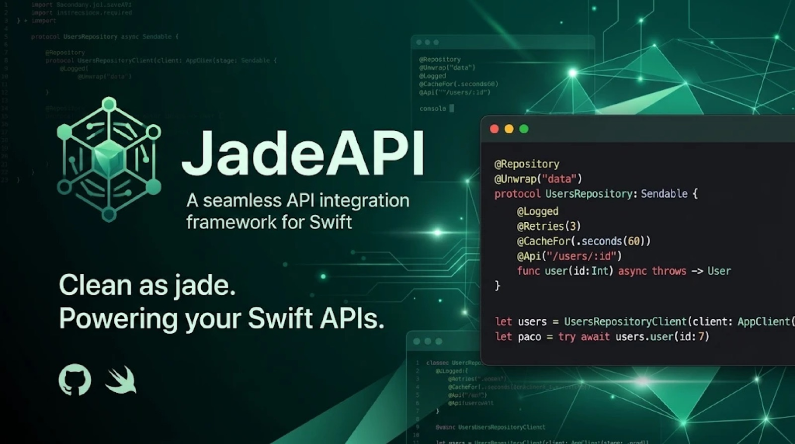

# JadeAPI



**Declara tu API con anotaciones; Jade la ejecuta.**

```swift
@Repository
protocol UsersRepository {
    @Retry(3)
    @Api("/users/:id")
    func getUser(id: Int) async throws -> User
}

let users: UsersRepository = UsersRepositoryClient(client: AppClient(baseURL: "https://api.ejemplo.com"))
let paco = try await users.getUser(id: 7)        // GET /users/7, con tres reintentos
```

Retrofit para Swift, con una diferencia: la política de cada endpoint (`@Retries`, `@CacheFor`,
`@Logged`, los tuyos) se apila sobre el mismo método y la escribe quien usa la librería.
Está construida sobre [AnnotationSwift](https://github.com/fsaldivar-dev/experimental-annotation-swift).

> Estado: 0.6.0. Niveles 1 y 2 completos, transporte avanzado y la seguridad del nivel 3. Lo que falta, y lo que se prometió y no está, en [docs/ROADMAP.md](docs/ROADMAP.md).

## Quick Start

**1. Dependencia** (Swift 6.2+):

```swift
.package(url: "https://github.com/fsaldivar-dev/jade-api.git", from: "0.6.0")
// target: .product(name: "JadeAPI", package: "jade-api")
```

**2. Declara el repositorio.** Un `protocol` `Sendable`; cada endpoint es un requisito `async throws` con `@Api`:

```swift
import JadeAPI

struct LoginForm: Decodable { let fields: [String] }
struct Token: Decodable { let value: String }

@Repository
protocol LoginRepository: Sendable {
    @Api func getLogin() async throws -> LoginForm                      // GET /login (inferido)
    @Api("/auth", method: .post)
    func auth(user: String, password: String) async throws -> Token     // POST /auth, body {user, password}
}
```

**3. Crea el cliente y la implementación.** `@Repository` generó `LoginRepositoryClient`:

```swift
let client = AppClient(baseURL: "https://api.ejemplo.com")
let login: LoginRepository = LoginRepositoryClient(client: client)
```

**4. Llama.** La llamada *es* la petición:

```swift
let form = try await login.getLogin()
let token = try await login.auth(user: "paco", password: "secreto")
```

## Declarar

### Verbo y ruta

| Declaración | Petición |
| --- | --- |
| `@Api("/users/:id") func user(id: Int)` | `GET /users/7` |
| `@Api("/auth", method: .post) func auth(user:password:)` | `POST /auth` con body `{"user":…,"password":…}` |
| `@Api func getUser(id: Int)` | `GET /user?id=7` (inferido; avisa que `id` va como query) |
| `@Api func postRefresh(token: String)` | `POST /refresh` con body `{"token":…}` |
| `@Api func deleteSession(id: Int)` | `DELETE /session?id=…` |
| `@Api func getUserProfile()` | `GET /user-profile` |

Prefijos que infieren verbo: `get`, `fetch`, `find`, `list`, `load` → GET · `post`, `create`, `add`, `send` → POST · `put`, `replace` → PUT · `patch`, `update` → PATCH · `delete`, `remove` → DELETE. Sin prefijo, GET. **La ruta explícita es la recomendación**; la inferencia es azúcar para prototipos y el compilador avisa cuando un parámetro podría ser de ruta.

### Parámetros

- `:nombre` en la ruta se rellena con el parámetro del mismo nombre.
- El resto va a la **query** en GET/DELETE y al **body JSON** (un campo por parámetro) en POST/PUT/PATCH.
- `nil` se omite de la query.
- Para forzar: `Path<T>`, `Query<T>`, `Header<T>` (el nombre del header es la etiqueta) y `Body<T>` (el parámetro completo es el body).

```swift
@Api("/users/search")
func search(q: String, page: Int?, limit: Query<Int>) async throws -> [User]   // ?q=…&limit=…

@Api("/me")
func me(token: Header<String>) async throws -> Profile                           // header "token: …"

@Api("/auth/login", method: .post)
func login(credentials: Body<Credentials>) async throws -> Token                 // body = credentials
```

### Retorno

`Decodable` (JSON), `Data`, `String`, `Void` o `Response` (status, headers, body crudos). Cualquier status fuera de 2xx lanza `HTTPError.status(code, response)`.

## Cliente y entornos

```swift
enum Stage: String, StageProtocol {
    case dev, prod, mock
    var baseURL: URL { … }
    var transport: any HTTPClient { self == .mock ? Fixtures.client : URLSessionClient() }
}

let stage = Stage.resolve(fallback: .prod)      // --stage=dev, JADE_STAGE=dev, o el fallback
let client = AppClient(stage: stage)
```

`AppClient` reúne base, `JSONDecoder`/`JSONEncoder`, headers comunes, timeout y transporte. Cambiar de entorno cambia el `AppClient`; los repositorios no se tocan.

## Probar sin red

```swift
import JadeTesting   // producto aparte: solo en tests y previews

let mock = MockClient()
    .on(.get, "/users/:id") { request in .json(#"{"id": 7, "name": "Paco"}"#) }
    .on(.post, "/auth") { request in request.body == nil ? .status(400) : .json(#"{"value": "t"}"#) }

let users: UsersRepository = UsersRepositoryClient(client: AppClient(baseURL: "https://mock.local", transport: mock))
#expect(try await users.user(id: 7).name == "Paco")
#expect(mock.received.first?.path == "/users/7")
```

Como el repositorio es un protocolo, también puedes escribir un mock a mano y no tocar ni la red ni la macro.

## Decoradores sobre endpoints

Cualquier decorador de AnnotationSwift se apila sobre un requisito y se aplica al método generado. Márcalo `@Annotation` y activa el plugin `JadeRegistry` en tu target para no declarar nada a mano:

```swift
.target(name: "App", dependencies: [.product(name: "JadeAPI", package: "jade-api")],
        plugins: [.plugin(name: "JadeRegistry", package: "jade-api")])
```


```swift
@Annotation
struct Retry: Decorator { … }

@Repository
protocol UsersRepository {
    @Retry(3)
    @Logged
    @Api("/users/:id/flaky")
    func flaky(id: Int) async throws -> User
}
```

Orden de arriba abajo: `Retry` envuelve a `Logged`, que envuelve la petición. Sin el plugin, declara el marcador (`@attached(peer) macro Retry(_ attempts: Int) = #externalMacro(module: "AnnotationMacros", type: "MarkerMacro")`) o usa `@Decorate(Retry(3), Logged())`. Las políticas de red (`@Retries`, `@CacheFor`, `@SingleFlight`, `timeout:`) no son decoradores sino [opciones de petición](#opciones-de-petición) que aplica el cliente.

## Ajustes del repositorio: base, headers y claves

Tres atributos sobre el protocolo evitan repetir lo mismo en cada endpoint o en cada cliente:

```swift
@Repository(service: "users")
@BaseURL("/v2")                                        // prefijo sobre la base del servicio; una URL completa la sustituye
@Headers(["X-Client": "ios", "Accept-Language": "es-MX"])
@KeyMapping(.snakeCase, dates: .iso8601)               // full_name ↔ fullName, fechas ISO, sin tocar el decoder del cliente
protocol UsersRepository: Sendable {
    @Headers(["X-Trace": "users"])                     // solo en este endpoint; gana sobre los del repositorio
    @Api("/users/:id") func user(id: Int) async throws -> User
}
```

Prioridad de headers: endpoint → repositorio → cliente/servicio. Un header con nombre de credencial y valor fijo dispara el aviso de `SecurityAudit` en Debug. `@BaseURL` y `@KeyMapping` solo van sobre el protocolo (sobre un requisito es error de compilación); en código, `client.with(base:)`, `with(headers:)` y `with(keys:dates:)` hacen lo mismo para un `AppClient`.

## Nivel 2: varios servicios

Cuando usuarios y pagos viven en hosts distintos, el repositorio declara **a qué servicio pertenece**, no a qué URL, y un `Environment` resuelve el resto:

```swift
@Repository(service: "payments")
protocol PaymentsRepository: Sendable {
    @Api("/charges/:id") func charge(id: String) async throws -> Charge
}

let environment = try Environment(bundle: .main)          // lee el Info.plist (ver abajo)
let payments: PaymentsRepository = try .live(in: environment)   // base, headers, interceptores y opciones de "payments"
```

### Dónde viven los entornos: xcconfig, el estándar de Xcode

Un `.xcconfig` por Build Configuration y un diccionario `JadeAPI` en el `Info.plist` con sustituciones `$(…)`. Lo que no está en `Release.xcconfig` no existe en el binario de tienda; eso es lo que un auditor comprueba (PCI DSS 6.5, OWASP MASTG).

```
// Config/Release.xcconfig
HTTPS = https:/$()/
JADE_STAGE = prod
JADE_USERS_BASE_URL    = $(HTTPS)users.api.ejemplo.com/v2
JADE_PAYMENTS_BASE_URL = $(HTTPS)payments.api.ejemplo.com/v3

// Config/Debug.xcconfig
JADE_STAGE = dev
JADE_PAYMENTS_BASE_URL = http:/$()/localhost:8080
#include? "Local.xcconfig"          // en .gitignore: tu sandbox, sin tocar git
```

```xml
<key>JadeAPI</key>
<dict>
    <key>stage</key><string>$(JADE_STAGE)</string>
    <key>services</key>
    <dict>
        <key>users</key>    <dict><key>baseURL</key><string>$(JADE_USERS_BASE_URL)</string></dict>
        <key>payments</key> <dict><key>baseURL</key><string>$(JADE_PAYMENTS_BASE_URL)</string>
                                  <key>timeout</key><string>10</string><key>retries</key><string>0</string></dict>
    </dict>
</dict>
```

Por servicio: `baseURL`, `headers`, `timeout`, `cache`, `retries`. `Environment` valida al arrancar: servicio ausente, URL inválida, `http://` fuera de Debug, y un header con nombre de credencial es error (los secretos no viven en la configuración). Para paquetes sin Info.plist, `Environment(plist:)` o `Environment(services:)` en código.

### Capas

Los interceptores, headers y opciones se componen de afuera hacia adentro: **entorno → servicio → repositorio (`@Interceptors`) → endpoint**. Así pagos puede tener su propio `AuthInterceptor` y usuarios otro, con el log común en la capa de entorno.

### Overrides de desarrollo

`environment.applyingLaunchOverrides()` lee `--service.payments=http://localhost:8080` y `JADE_SERVICE_PAYMENTS=…`. **Solo compila en Debug**: en release la función no existe, así que nada externo puede mover el tráfico.

### Probar un módulo con un solo servicio falso

```swift
let environment = try Environment(plist: fixtures)
    .mocking("payments", with: MockClient().on(.post, "/charges") { _ in .json(Fixtures.charge) })
let payments: PaymentsRepository = try .live(in: environment)    // el resto del entorno, intacto
```

Sin `service:`, el repositorio usa el servicio por defecto y `AppClient(baseURL:)` sigue funcionando: el nivel 1 no cambia.

## Interceptores

Tocan el HTTP crudo. Una función y un `next`, igual que un decorador:

```swift
struct SignRequest: Interceptor {
    func intercept(_ request: Request, next: Next) async throws -> Response {
        var request = request
        request.headers["X-Signature"] = sign(request.body)
        return try await next(request)
    }
}

let client = AppClient(stage: .prod, interceptors: [
    AuthInterceptor(tokens: keychain),       // Authorization + refresh único ante 401, aunque haya N en vuelo
    CommonHeaders(["Accept-Language": "es-MX"]),
    RequestLogger(.curl),                    // redacta Authorization y Cookie
])
```

El primero es el más externo. `RequestAdapter` (solo antes) y `ResponseInterceptor` (solo después) son atajos de una función. Por repositorio, `@Interceptors(SignRequest())` sobre el `protocol` los añade por dentro de los del cliente.

## Transformadores

Tocan los datos, con tipos verificados por el compilador:

```swift
struct UserMapper: Transformer {
    func transform(_ dto: UserDTO) throws -> User { User(id: dto.id, name: dto.full_name) }
}

@Repository
@Unwrap("data")                               // la API envuelve todo en {data: …}
@ErrorTransform(APIErrorMapper.self)          // body de error → error de dominio
protocol UsersRepository: Sendable {
    @Transform(UserMapper.self)
    @Api("/users/:id")
    func user(id: Int) async throws -> User     // la red manda UserDTO; tú recibes User

    @Unwrap("data.items")                     // el del requisito gana
    @Api("/users")
    func all() async throws -> [UserDTO]
}
```

`@Unwrap` admite rutas de claves. Si el body de error no decodifica como `Input`, sube el `HTTPError` original.

## Opciones de petición

Se declaran sobre el endpoint o el repositorio y las aplica el cliente justo antes del transporte:

```swift
@Repository
@Retries(3, backoff: .exponential(.milliseconds(200)))   // transporte, 5xx, 408, 429; respeta Retry-After
protocol CatalogRepository: Sendable {
    @CacheFor(.seconds(60))                               // 2xx en memoria por verbo + URL + body
    @Api("/catalog")
    func catalog() async throws -> [Product]

    @SingleFlight                                         // idénticas en vuelo comparten respuesta
    @Api("/catalog/:id", timeout: .seconds(2))            // HTTPError.timeout; un timeout también se reintenta
    func product(id: Int) async throws -> Product
}
```

Nunca se reintenta un 4xx de negocio ni un error de decodificación. `AppClient.options` da los defaults del cliente; el repositorio y el endpoint ganan campo a campo.

## Grupos de peticiones

La concurrencia es de quien llama, no de quien declara:

```swift
// N iguales, con límite y resultados en orden; si una falla, cancela el resto
let users = try await client.group(maxConcurrent: 3) { group in
    for id in ids { group.add { try await repo.user(id: id) } }
}

// igual, pero sin lanzar: un Result por operación
let settled = await client.groupSettled(maxConcurrent: 3, progress: { print($0.fractionCompleted) }) { group in … }

// pocas distintas, cada una con su tipo
let (featured, offers, categories) = try await client.all(
    { try await catalog.featured() }, { try await catalog.offers() }, { try await catalog.categories() }
)
```

Para dos o tres distintas sin límite, `async let` del lenguaje basta.

## Streams

`kind:` en `@Api` elige la familia de retorno; el stream empieza al hacer `await` del requisito y el status se valida antes de entregarlo (un 401 lanza `HTTPError.status` con el body completo, no un stream vacío):

```swift
@Repository
protocol FeedRepository: Sendable {
    @Api("/export", kind: .bytes)   func export() async throws -> AsyncThrowingStream<Data, any Error>
    @Api("/log", kind: .lines)      func log() async throws -> AsyncThrowingStream<String, any Error>
    @Api("/completions", method: .post, kind: .ndjson)
    func complete(prompt: String) async throws -> AsyncThrowingStream<Chunk, any Error>   // un JSON por línea
    @Api("/events", kind: .sse)     func events() async throws -> AsyncThrowingStream<ServerEvent, any Error>
}

for try await chunk in try await feed.complete(prompt: "hola") { … }   // cancelar la Task cierra el stream
```

Sobre URLSession los trozos llegan conforme el servidor los manda; cualquier `HTTPClient` sin streaming nativo entrega el body de una pieza. Los interceptores solo adaptan la petición (headers, auth): la respuesta no termina, así que no se intercepta. `@Retries` reintenta la conexión; `timeout` es el de conexión. En tests, `MockClient.onStream` entrega trozos partidos donde quieras.

## Descargas y subidas

```swift
@Repository
protocol FilesRepository: Sendable {
    @Api("/files/:id", kind: .download)                 func export(id: Int) async throws -> Download
    @Api("/media", method: .post, kind: .upload)        func upload(file: Body<FileUpload>) async throws -> Upload
}

let download = try await files.export(id: 7)          // la petición ya salió
for await progress in download.progress { print(progress.fractionCompleted ?? 0) }
let url = try await download.file()                   // o download.pause() → resumeData, download.resume(), download.cancel()

let upload = try await files.upload(file: Body(FileUpload(url: photo, mimeType: "image/jpeg", fields: ["album": "x"])))
let created: Created = try await upload.value()       // multipart/form-data con progreso
```

`Body<FileUpload>` y `Body<Multipart>` se codifican como multipart; `Body<Data>` viaja crudo; cualquier otro `Encodable`, como JSON. `DownloadQueue(maxConcurrent:)` encola descargas con progreso agregado, `results()` en orden y `settled()` sin lanzar. Todo sobre `URLSession` con delegado por tarea; `MockClient` simula progreso y archivos para los tests.

## WebSocket

```swift
@Repository
protocol ChatRepository: Sendable {
    @Socket("/ws/chat/:room")
    func chat(room: String) async throws -> Socket<Outgoing, Incoming>
}

let chat = try await rooms.chat(room: "general")      // espera el handshake; lanza si lo rechazan
try await chat.send(Outgoing(text: "hola"))
for try await message in chat.messages { … }         // termina al cerrar; lanza si la conexión cae
chat.close()
```

`String` viaja como texto, `Data` como binario y cualquier `Codable` como JSON. `https://` se convierte en `wss://` (y `http://` en `ws://`, solo en Debug). No reconecta solo: si la conexión cae, `messages` termina con error y tú decides. Para pruebas, `JadeTesting` trae `LocalWebSocketServer`, un servidor eco real sobre Network.framework, que es con lo que se prueba la librería.

## Nivel 3: seguridad bancaria

Todo vive detrás de protocolos: lo real (Keychain, TLS, Secure Enclave, DeviceCheck) en dispositivo; dobles en memoria para pruebas y simulador. El detalle y el mapeo MASVS están en [SECURITY.md](SECURITY.md).

```swift
let keychain = SecItemKeychainStore(service: "mx.banco.app", protection: .biometryCurrentSet)
let tokens = KeychainTokenProvider(store: keychain) { refresh in try await auth.refresh(refresh) }
let deviceKey = try P256SigningKey.load(from: keychain)            // Secure Enclave si el dispositivo lo tiene

let environment = try Environment(bundle: .main)                    // pins por servicio en el Info.plist
var secured = environment
secured.interceptors = [
    AppAttestInterceptor(attestor: DeviceCheckAttestor(), challenges: server, store: keychain),  // solo tu app, sin modificar
    DPoPInterceptor(key: deviceKey, tokens: tokens),               // token atado al dispositivo (FAPI 2.0)
    SignedRequestInterceptor(key: deviceKey, coveredHeaders: ["idempotency-key"]),  // RFC 9421 + Content-Digest
]
```

| Pieza | Estándar | Qué hace |
| --- | --- | --- |
| `KeychainTokenProvider` | MASVS-STORAGE/AUTH | Tokens en Keychain atados al dispositivo y, opcionalmente, a la biometría actual; refresca al caducar |
| `PinningPolicy` + `URLSessionClient.pinned` | MASVS-NETWORK-2 | Pins `sha256/` de clave pública por host, con respaldo y caducidad; en el Info.plist como `pins` y `pinsExpire` |
| `DPoPInterceptor` | RFC 9449, FAPI 2.0 | Prueba ES256 por petición con la clave del dispositivo; `Authorization: DPoP`; reintento con `DPoP-Nonce` |
| `SignedRequestInterceptor` | RFC 9421, RFC 9530 | Firma método, URI, `Content-Digest`, `created`, `nonce` y los headers que elijas |
| `AppAttestInterceptor` | App Attest | Atesta la clave una vez con el challenge del servidor y asierta cada petición |
| `P256SigningKey` | CryptoKit | Clave P-256 en Secure Enclave cuando existe; persistida vía `KeychainStore` |
| `AuthorizationFlow` | OIDC Discovery, RFC 8252, PKCE (7636), PAR (9126), FAPI 2.0 | Login en el navegador del sistema con tokens atados por DPoP |

### Login al estilo FAPI 2.0

`AuthorizationFlow` hace el login de app nativa completo: discovery del issuer (`/.well-known/openid-configuration`, con el `issuer` verificado y solo endpoints `https`), **PAR** si el servidor lo ofrece o lo exige (el navegador solo ve `request_uri`), **PKCE S256**, navegador del sistema con `ASWebAuthenticationSession` (nunca un WebView), intercambio del código con **prueba DPoP** para que los tokens nazcan atados al dispositivo, y comprobación de `iss`, `aud`, `exp` y `nonce` del `id_token`.

```swift
let flow = AuthorizationFlow(
    issuer: URL(string: "https://auth.banco.mx")!, clientID: "app-ios",
    redirectURI: URL(string: "mx.banco.app://callback")!, scopes: ["openid", "accounts"],
    client: try environment.client(for: "auth"), key: deviceKey, presenter: WebAuthenticationPresenter())

let tokens = try await flow.signIn()
let provider = KeychainTokenProvider(store: keychain) { try await flow.refresh($0) }
try await provider.store(tokens)
```

El cliente es público: no hay `client_secret` en la app (RFC 8252). En pruebas, un `AuthorizationPresenter` falso devuelve la URL de redirección y todo el flujo corre contra `MockClient`.

Lo que no está aquí porque no es de la capa de red: anti-tampering, ofuscación y detección de jailbreak. Y lo que decide la seguridad de verdad vive en tu servidor: verificar cada prueba, cada firma y cada `Idempotency-Key`.

## Defaults seguros (nivel 1)

Sin configurar nada, el cliente ya cumple lo que un auditor móvil revisa primero (OWASP MASVS-NETWORK y STORAGE, PCI DSS 6.5):

- **Solo HTTPS fuera de Debug.** Una base `http://` lanza `HTTPError.insecureURL` antes de salir. En Debug se permite para apuntar a `localhost`. Ajustable con `client.security`.
- **Un reintento nunca duplica un pago.** `@Retries` solo aplica a verbos idempotentes. Un `POST` o `PATCH` con reintentos exige `@Idempotent`, que manda una `Idempotency-Key` única por llamada y la repite en cada reintento; el compilador lo rechaza si falta, y el cliente lo vuelve a comprobar en runtime.
- **Logs mudos en release.** `RequestLogger` no escribe nada en una build de release salvo `enabledInRelease: true`, y en Debug redacta headers, query y body con nombres de credencial o de tarjeta (`Authorization`, `X-Api-Key`, `password`, `otp`, `cvv`, …).
- **Nada de pruebas en el binario.** `MockClient` vive en el producto `JadeTesting`; la app no lo enlaza.
- **Aviso de secretos.** En Debug, un header con nombre de credencial y valor fijo (`CommonHeaders(["X-Api-Key": "…"])`) imprime una advertencia: todo lo que va en el cliente es público.

Lo que la librería no puede hacer por ti: autorizar en el servidor, guardar el token en el Keychain (viene en el nivel 3 con `KeychainTokenProvider`), ni evitar que alguien lea las URLs de producción, que no son secreto.

## Concurrencia

Declara los repositorios como `protocol X: Sendable`. El cliente generado es `Sendable` (solo guarda un `AppClient`), y así el existencial `any X` puede vivir en un `@MainActor` y llamarse desde cualquier aislamiento. Las llamadas corren en el aislamiento de quien llama.

## Errores

`HTTPError` es un enum: `invalidURL`, `encoding`, `transport`, `status(Int, Response)`, `decoding(Error, Response)`, `unmocked(Request)`, `cancelled`. Cancelar la `Task` cancela la petición.

## Ejemplo

[`Examples/Login`](Examples/Login): app SwiftUI con selector de entorno (dev, prod, mock), dos servicios (`auth` y `catalog`) resueltos por `Environment` y `live(in:)`, `.xcconfig` de muestra en `Config/`, login con repositorios declarados, `@Logged @Retry(2)` registrados con `@Annotation` y el plugin, y un catálogo que usa toda la fase 2: `AuthInterceptor` + `RequestLogger`, `@Unwrap` + `@Transform` + `@ErrorTransform`, `@Retries` (la primera carga recibe un 503), `@CacheFor`, `@SingleFlight`, `timeout`, `client.all` y `groupSettled`.

Está organizado como una app real: un target `LoginCore` (dominio, red, entorno, features y raíz de composición) que se prueba sin UI, y la app SwiftUI encima. Ver su [README](Examples/Login/README.md).

```bash
swift run --package-path Examples/Login            # app (entorno mock por defecto)
swift test --package-path Examples/Login           # lógica contra los fixtures
```

## Cómo funciona

`@Repository` genera `struct <Nombre>Client: <Nombre>, Sendable` marcado `@Decorable`, con `init(client:)` y un método por requisito que arma un `Endpoint` y llama a `AppClient`. Los atributos del requisito, menos `@Api`, se copian al método generado; a partir de ahí AnnotationSwift envuelve la pila como en cualquier función. El cuerpo generado para `@Api("/users/:id") func user(id: Int)`:

```swift
public func user(id: Int) async throws -> User {
    let __headers: [String: String] = [:]
    let __endpoint = JadeAPI.Endpoint(name: "user(id:)", method: .get, path: "/users/:id",
                                      pathParameters: ["id": JadeAPI.ParameterValue.text(id) ?? ""],
                                      query: [], headers: __headers, body: nil)
    return try await client.perform(__endpoint)
}
```

Tres capas, una regla: **interceptor** si tocas HTTP, **decorador** si tocas la llamada, **transformador** si tocas datos. Las opciones (`@Retries`, `@CacheFor`, `@SingleFlight`, `timeout`) viven con el HTTP, por eso las aplica el cliente y no un decorador: así funcionan con cualquier tipo de retorno y respetan `Sendable`.

## Documentación

Catálogo DocC con Quick Start y los niveles: `swift package generate-documentation --target JadeAPI`, o
*Product → Build Documentation* en Xcode.

## Requisitos

Swift 6.2 o superior (Xcode 26.1+). macOS 13, iOS 16, tvOS 16, watchOS 9, visionOS 1.

## Licencia

MIT. Ver [LICENSE.md](LICENSE.md).
